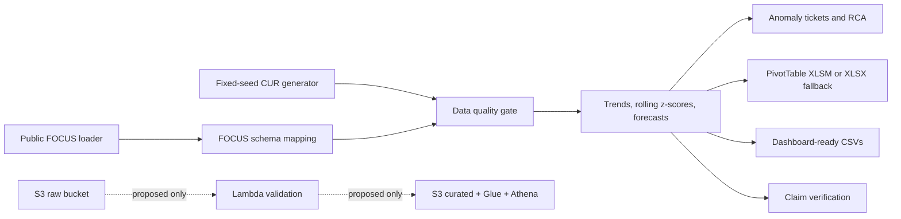

# Cloud Cost Anomaly and FinOps Analysis

Reproducible synthetic CUR analysis with regional anomaly triage, forecast backtesting, tag KPIs, a native Excel report on Windows, and a separate full public FOCUS path.

## Dashboard (in progress)
An interactive dashboard is under development and will be added to this repo within 24 hours. Dashboard-ready data and the spec are already in /dashboard.

## Architecture



The AWS path is defined and lint-validated, **not deployed**. The interactive dashboard is not part of this repository.

## Run

```powershell
python -m pip install -r requirements.txt
python run_all.py
```

On systems with GNU Make, `make all` runs the same pipeline. Run quality tests with `python -m pytest -q`. To download and analyze the complete public FOCUS dataset, run `python scripts/load_real_data.py`; network failure writes manual-download instructions. Use `--sample` only for the publisher's 1,000-row smoke-test file.

## Results

| Path | Measured output |
|---|---|
| Synthetic, fixed seed | 11,928 line items, 426 daily dates (14 calendar months), 7 services, 4 regions. |
| Synthetic anomaly analysis | 33 flagged service-days; regional scoring finds 2 candidates among those alerts (regional scan: 441 absolute cost-z flags, 227 positive, 51 with unit-cost deviation >15%). EC2 `us-east-1` is one candidate: regional unit-cost deviation +72.26%, regional unit-cost z=7.787. The pooled service/day secondary deviation remains +40.20%. The 33-to-1 funnel does not hold at strict regional grain; observed result is 33-to-2. |
| Synthetic forecast | Regression $82,164.37; exponential smoothing $82,631.24; agreement 0.567%. Rolling-origin MAPE: 7.53% and 8.00% over 11 30-day origins. |
| Synthetic tags | Resource-record compliance 70.60% in the first month and 92.74% in the last; records proxy resources because the fixture has no resource ID. |
| Simulated savings | $5,840.64 counterfactual opportunity for the injected EC2 period; not realized or validated savings. |
| Public FOCUS full dataset | 5,488,359 source rows mapped with none rejected; 117 services, 58 regions, and two observed calendar months (March and September 2024; dates span 2024-03-20 to 2024-09-30). The run flagged 153 service-days; independent regional scoring found 641 regional cost-z alerts and 45 strict unit-cost candidates overall, of which 14 overlap the primary service-day alerts. The data-quality report records 103,990 signed negative-cost rows and 18,127 null quantities on Credit/Tax/Purchase rows; costs are retained. Forecast status is suppressed: zero rolling-origin holdouts, so no forecast or agreement value is published. |

Numbers above come from the checked-in sample/source and the generated outputs below; rerun `python run_all.py` to reproduce synthetic figures. The real sample is fetched separately and is not used to support synthetic results.


| claim area | Evidence |
|---|---|
| 14 months, 7 services, 4 regions; 33 service-day anomalies; two regional candidates, including EC2 `us-east-1` at +72.26% | [scripts/analyze.py](scripts/analyze.py), [scripts/analysis_metrics.py](scripts/analysis_metrics.py), [sql/trend_analysis.sql](sql/trend_analysis.sql), [outputs/synthetic/analysis_summary.json](outputs/synthetic/analysis_summary.json), [outputs/synthetic/regional_inefficiency_candidates.csv](outputs/synthetic/regional_inefficiency_candidates.csv), [outputs/synthetic/anomalies_detected.csv](outputs/synthetic/anomalies_detected.csv). This is a modeled candidate, not verified production waste. The pooled +40.20% is secondary and service/day-grain; the strict 33-to-1 funnel does not hold at regional grain (33-to-2 observed). |
| ~$82K synthetic forecast, 0.567% agreement, backtest, Excel report | [outputs/synthetic/analysis_summary.json](outputs/synthetic/analysis_summary.json), [outputs/synthetic/forecast_backtest.csv](outputs/synthetic/forecast_backtest.csv), [reports/monthly_finops_report.xlsm](reports/monthly_finops_report.xlsm), [reports/monthly_finops_report.xlsx](reports/monthly_finops_report.xlsx), [macros/refresh_report.bas](macros/refresh_report.bas), [docs/excel_macro_howto.md](docs/excel_macro_howto.md). On this Windows build the XLSM has three native PivotTables (service x month, region, tag compliance by service) and an embedded refresh macro invoked during generation. Subsequent refresh is manual. On non-Windows/no-Excel builds the XLSX is formula-driven fallback. No reporting-effort reduction is measured. |
| Unit-cost, anomaly, tag KPIs and BI roadmap | [docs/metrics_definitions.md](docs/metrics_definitions.md), [docs/bi_roadmap.md](docs/bi_roadmap.md), [docs/requirements.md](docs/requirements.md), [outputs/synthetic/tag_compliance_by_service_region_month.csv](outputs/synthetic/tag_compliance_by_service_region_month.csv). |
| Data validation and anomaly RCA | [outputs/synthetic/data_quality_report.md](outputs/synthetic/data_quality_report.md), [tickets/tickets_summary.csv](tickets/tickets_summary.csv), [tickets/ec2_us_east_1_rca.md](tickets/ec2_us_east_1_rca.md), [docs/rca_template.md](docs/rca_template.md). |
| Public FOCUS full mapping and forecast suppression | [outputs/real_data/README.md](outputs/real_data/README.md), [outputs/real_data/mapping_report.md](outputs/real_data/mapping_report.md), [outputs/real_data/data_quality_report.md](outputs/real_data/data_quality_report.md), [outputs/real_data/analysis_summary.json](outputs/real_data/analysis_summary.json), [outputs/real_data/forecast_assessment.json](outputs/real_data/forecast_assessment.json). |
| Dashboard preparation | [dashboard/dashboard_spec.md](dashboard/dashboard_spec.md) and [dashboard/data/](dashboard/data/); no dashboard UI or screenshot is included. |
| AWS pipeline design | [infra/cloudformation.yaml](infra/cloudformation.yaml), [infra/README.md](infra/README.md), [lambda/handler.py](lambda/handler.py). Defined and cfn-lint validated; not deployed. |

## Public Data

The optional real-data path downloads the complete FinOps Foundation [FOCUS 1.0 dataset](https://media.githubusercontent.com/media/FinOps-Open-Cost-and-Usage-Spec/FOCUS-Sample-Data/main/FOCUS-1.0/focus_data_table.csv.gz), described by its publisher as anonymized real-world data. The source repository's [license](https://raw.githubusercontent.com/FinOps-Open-Cost-and-Usage-Spec/FOCUS-Sample-Data/main/license.md) is CC BY 4.0. The full run read and mapped 5,488,359 rows; dates span March through September 2024, with March and September as the two months containing rows. The quality and mapping reports document signed costs, allowed null quantities, and 163 missing calendar dates. Outputs stay under `outputs/real_data/`. With zero eligible 30-day rolling-origin holdouts, the real-data forecast is suppressed. The raw 496 MB compressed source and mapped line-item CSV are excluded from Git and the ZIP; rerun the loader to fetch/map them.

## Data and Limitations

All generated demo data is synthetic, fixed-seed, and contains no employer billing data, secrets, personal data, or employer-specific confidential information. It mirrors common FinOps analysis patterns only. Synthetic regional “inefficiency” candidates and savings are modeled scenarios, not production findings. The Excel budget inputs are blank; no budget variance is claimed. Excel COM created the native PivotTables and embedded VBA macro in this Windows run; other environments get the XLSX fallback. Subsequent macro refresh is manual and may be blocked by local policy. The AWS template has not been deployed. Public FOCUS tags use a separate vocabulary, and negative amounts are retained for reconciliation rather than treated as synthetic cost anomalies.
