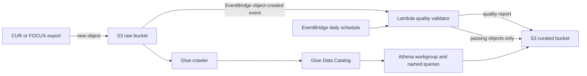

# Proposed AWS Pipeline

This CloudFormation template is defined for review and passed local `cfn-lint` validation; it has **not been deployed**. No uptime, refresh SLA, cost savings, or production-readiness claim is made.

## Resources and Controls

- Private, versioned, AES-256 encrypted raw and curated S3 buckets with public access blocked.
- Glue database and crawler over the validated curated prefix; Athena workgroup with a curated-bucket query-results location and two named queries.
- Lambda validates incoming CSV objects using `scripts/data_quality.py`, writes a markdown report, and copies only passing objects to the curated prefix.
- EventBridge rules invoke validation for new S3 objects and on a daily schedule.
- IAM roles scope S3 actions to the project buckets/prefixes and Glue catalog resources. Lambda dependencies are supplied as a region-compatible layer; the artifact bucket/key are deployment inputs.
- Tags are applied to resources that support tags. The Glue database schema accepts catalog parameters rather than a `Tags` property; Athena `NamedQuery` and Lambda `Permission` resources also do not expose tag properties in CloudFormation. Project/owner metadata is recorded in the Glue database parameters and named-query descriptions.

## Deploy Steps

1. Install AWS CLI, configure an explicitly authorized account/profile, and install `cfn-lint`.
2. Package `lambda/handler.py` as `handler.py` and include `scripts/data_quality.py` at the package root under `scripts/`. Publish a Lambda layer containing compatible, pinned pandas/numpy dependencies.
3. Upload the package to a private artifact bucket.
4. Run `cfn-lint infra/cloudformation.yaml` and review IAM, retention, data location, and budget implications with security and finance.
5. Deploy with `aws cloudformation deploy --template-file infra/cloudformation.yaml --stack-name finops-cost-pipeline --capabilities CAPABILITY_IAM --parameter-overrides ArtifactBucket=... LambdaArtifactKey=... DataQualityLayerArn=...`.
6. Upload CUR/FOCUS files under the raw bucket's `incoming/` prefix and inspect quality reports before querying curated data.

Do not deploy without account-specific review of data residency, encryption keys, retention, IAM, and costs.